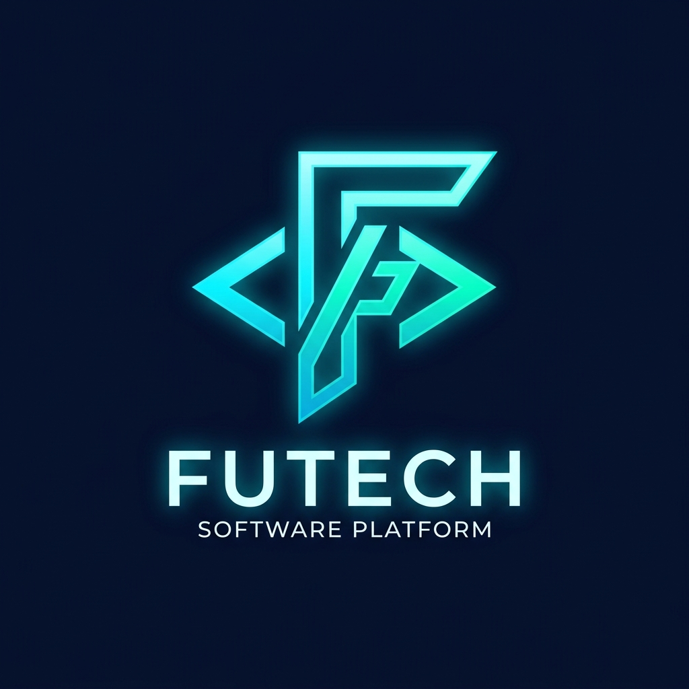

# 🚀 منصة فوتيك (FuTech Platform)
### حاضنة الكفاءات البرمجية العربية — ملتقى نخبة المطورين لإنجاز المشاريع باحترافية

<p align="center">
  
</p>

<p align="center">
  <strong>سوق برمجيات حر ومتكامل يربط أصحاب المشاريع والشركات بأمهر مهندسي البرمجيات في العالم العربي وفق معايير جودة الكود (FQS)، مع توثيق تقني متقدم ودعم مستمر.</strong>
</p>

<p align="center">
  
  
  
  
  
  
</p>

---

## 🌟 ركائز ومميزات المنصة

- 🛡️ **معيار جودة المستقل (FQS - Freelancer Quality Score):** خوارزمية قياس دقيقة مبنية على 4 عوامل أساسية (معدل إكمال المشاريع، الالتزام بالوقت والميزانية، تقييمات العملاء، ومعدل التوظيف المتكرر).
- 📦 **سياسة تسليم الكود المعتمدة (Git Handover):** نقل ملكية مستودعات GitHub / GitLab بالكامل مع ملفات README و Dockerfile و .env.example.
- 🤝 **دعم فني وتذاكر صيانة مستمرة (Ongoing Support SLA):** تتبع حالة المشاريع وتذاكر الصيانة وحزم الدعم بعد التسليم.
- 📚 **مركز المعرفة والتوثيق البرمجي (Docs Hub):** شروحات تفصيلية لمعايير الأمان، إرشادات OWASP، وتوثيق APIs.
- ⚡ **تعاقد وتسليم مباشر:** خالٍ تماماً من أي بوابات دفع أو اقتطاعات وسيطة لضمان الشفافية وحرية التعاقد.

---

## 🛠️ التقنيات المستخدمة (Tech Stack)

- **Frontend:** React 19, TypeScript, Tailwind CSS v4, Framer Motion
- **Routing & State:** Wouter, Local Persistence Store
- **UI Components:** Lucide Icons, Custom Radix UI Design System
- **Build System:** Vite 7, PNPM Workspaces

---

## 🚀 التشغيل والتطوير المحلي (Quick Start)

```bash
# 1. استنساخ المستودع
git clone https://github.com/minarob23/futech-platform.git
cd futech-platform

# 2. تثبيت الحزم البرمجية
pnpm install

# 3. تشغيل خادم التطوير
pnpm start
# أو
pnpm run dev
```

التطبيق سيعمل محلياً على: `http://localhost:3000`

---

## 📄 الترخيص (License)

هذا المشروع مرخص تحت رخصة [MIT](LICENSE). جميع الحقوق محفوظة لمنصة فوتيك.
